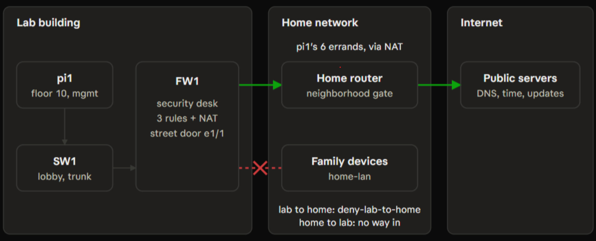

## Current Status

**Day 10: First firewall rules.**

- Day 1: every device identified from its labels and checked against manufacturer support dates.
- Day 2: fixed a server memory fault by reseating one DIMM.
- Day 3: reached the switch over its console and cleared a previous owner's leftover VLANs.
- Day 4: wrote the lab's IP plan, created its VLANs on the switch, and brought up a Raspberry Pi on a fixed lab address, isolated from the home network.
- Day 5: rebuilt the Pi as a minimal server with key-only SSH, hardened the switch (SSH-only management on the MGMT VLAN), and made the Pi the jump box for managing the switch.
- Day 6: first power-on of the firewall under supervision, read-only inventory of its software and licenses, and a new admin password committed.
- Day 7: rotated the switch's credentials after an exposure and audited this repository for leaked details.
- Day 8: secured the switch (named hostname, SSH-only management on the management VLAN, a trunk port ready for the firewall, unused ports locked), and set up the firewall's three lab zones on VLAN subinterfaces, with traffic between zones blocked by default.
- Day 9: moved the laptop and Raspberry Pi onto the management VLAN, connected the firewall to the switch with a VLAN trunk, and got the firewall's first reply from the lab.
- Day 10: connected the firewall's outside port to the home router, proved the home network can't reach the lab, and wrote the first three logged rules: the lab can never reach a home device, the jump box may fetch updates and time, and everything else is blocked. [Policy and proof](docs/network/fw1-policy.md).

Full record: [power-on log](docs/inventory/power-on-log.md).

## The lab

| Role | Device | Status |
| --- | --- | --- |
| Firewall and router between lab zones | Palo Alto PA-220 | 	Running: three lab zones plus an outside zone; first logged security rules and outbound NAT (Day 10) |
| Lab switch | Cisco Catalyst 2960G-24TC-L | Running: VLANs 10, 20, 30 and 999; trunk to the firewall; SSH-only management |
| Virtualization server | Dell PowerEdge R730 (Proxmox VE planned) | Hardware verified, (not yet cabled) |
| Monitoring / jump box | Raspberry Pi 4 | Running: jump box on MGMT; updates and time through the firewall only |
| Cloud | AWS | Planned |

Shelved as spares: a second 2960G, a Catalyst 3560G and a Cisco ISR 4331. The lab runs only what earns its place.

## Roadmap

1. Infrastructure: segmented network behind the firewall, Proxmox, backups
2. AI-powered IT Operations Command Center
3. Enterprise Knowledge Hub (RAG with citations)
4. AI business document automation
5. Hybrid cloud deployment on AWS
6. AI cloud cost advisor

## Repository Layout

- `docs/inventory/`: hardware inventory, verified specs and the power-on log
- `docs/network/`: IP plan, cabling and switch configuration notes
- `docs/build/`: build logs for each device
- `docs/diagrams/`: architecture diagrams
- `docs/decisions/`: one short file per architecture decision
- `projects/`: application code, added as each project starts
