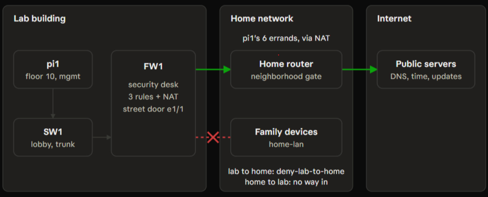

# FW1 security policy and NAT


Device: FW1, Palo Alto PA-220, PAN-OS 9.1.15-h1
Committed: Day 10 (Sat Nov 7, 2026), commit job 5, no warnings
Related: [FW1 outside interface](fw1-outside.md) · [IP plan](ip-plan.md)

The first rules follow least privilege: the lab may never start a connection to a home device, one host may run six named errands to the internet, and everything else leaving the lab is blocked and logged.

## Address objects

| Name | Value | Purpose |
| --- | --- | --- |
| `home-lan` | The home network (kept private) | Lets rules name the home network without publishing its address |
| `pi1` | 10.20.10.10/32 | The jump box, a single address |

## Security rules (read top to bottom; first match wins)

| Order | Rule | From zone | To zone | Source | Destination | Applications | Service | Action | Log |
| --- | --- | --- | --- | --- | --- | --- | --- | --- | --- |
| 1 | `deny-lab-to-home` | mgmt, platform, apps | untrust | any | `home-lan` | any | any | deny | yes |
| 2 | `allow-pi1-updates` | mgmt | untrust | `pi1` | any | dns, ntp, ping, web-browsing, ssl, apt-get | application-default | allow | yes |
| 3 | `deny-lab-outbound-other` | mgmt, platform, apps | untrust | any | any | any | any | deny | yes |
| built in | `intrazone-default` | same zone | same zone | | | | | allow | no |
| built in | `interzone-default` | all other | | | | | | deny | no |

### Why this order

- **Rule 1 is on top** because rule 2's destination is "any", which includes the home network. With rule 1 first, no later mistake (even an "allow any") can reach a home device.
- **Rule 3 is last** because it would otherwise block rule 2's allowed traffic.
- **Rules 1 and 3 duplicate the built-in deny on purpose.** The built-in deny writes nothing to the traffic log; these two make every block visible, with a rule name.
- **`application-default`** means each application is allowed only on its normal ports, so DNS on port 53, HTTPS on 443.

## NAT

| Rule | From | To | Translation |
| --- | --- | --- | --- |
| `nat-lab-outbound` | mgmt, platform, apps | untrust | Source: dynamic IP and port, using ethernet1/1's address |

The home router has no route to 10.20.x, so lab traffic leaves with FW1's outside address. NAT changes only the return address; the security rules still decide what may leave, so one NAT rule safely covers all three lab zones.

## Commands (FW1 configure mode, one line at a time)

```
set address home-lan ip-netmask <HOME-SUBNET>
set address home-lan description "Family network: the lab may never start connections here"
set address pi1 ip-netmask 10.20.10.10/32
set address pi1 description "PI1 jump box"

set rulebase security rules deny-lab-to-home from [ mgmt platform apps ]
set rulebase security rules deny-lab-to-home to untrust
set rulebase security rules deny-lab-to-home source any
set rulebase security rules deny-lab-to-home destination home-lan
set rulebase security rules deny-lab-to-home application any
set rulebase security rules deny-lab-to-home service any
set rulebase security rules deny-lab-to-home action deny
set rulebase security rules deny-lab-to-home log-end yes

set rulebase security rules allow-pi1-updates from mgmt
set rulebase security rules allow-pi1-updates to untrust
set rulebase security rules allow-pi1-updates source pi1
set rulebase security rules allow-pi1-updates destination any
set rulebase security rules allow-pi1-updates application [ dns ntp ping web-browsing ssl apt-get ]
set rulebase security rules allow-pi1-updates service application-default
set rulebase security rules allow-pi1-updates action allow
set rulebase security rules allow-pi1-updates log-end yes

set rulebase security rules deny-lab-outbound-other from [ mgmt platform apps ]
set rulebase security rules deny-lab-outbound-other to untrust
set rulebase security rules deny-lab-outbound-other source any
set rulebase security rules deny-lab-outbound-other destination any
set rulebase security rules deny-lab-outbound-other application any
set rulebase security rules deny-lab-outbound-other service any
set rulebase security rules deny-lab-outbound-other action deny
set rulebase security rules deny-lab-outbound-other log-end yes

set rulebase nat rules nat-lab-outbound from [ mgmt platform apps ]
set rulebase nat rules nat-lab-outbound to untrust
set rulebase nat rules nat-lab-outbound source any
set rulebase nat rules nat-lab-outbound destination any
set rulebase nat rules nat-lab-outbound service any
set rulebase nat rules nat-lab-outbound source-translation dynamic-ip-and-port interface-address interface ethernet1/1
```

Each rule also has a one-line description. Snapshot before the change: `day10-before-s3.xml`.

## Proof with real traffic (from pi1)

| Test | From pi1 to | Expected | Actual | Rule FW1 logged |
| --- | --- | --- | --- | --- |
| ping | 1.1.1.1 | allow | 4/4 replies | `allow-pi1-updates` (ping) |
| DNS | 1.1.1.1 and 9.9.9.9 | allow | deb.debian.org resolved | `allow-pi1-updates` (dns-base) |
| NTP | internet time servers | allow | Clock synchronized | `allow-pi1-updates` (ntp-base) |
| HTTPS | www.debian.org:443 | allow | HTTP/2 200 | `allow-pi1-updates` (ssl) |
| apt update | Debian and Raspberry Pi package servers | allow | 1.9 MB fetched; 35 packages upgradable | `allow-pi1-updates` (apt-get) |
| ping | the home router | deny | 0/4 replies | `deny-lab-to-home` |
| SSH | github.com:22 | deny | Connection timed out | `deny-lab-outbound-other` |

## Traffic log excerpt (sanitized, newest first)

```
Time                 App             From   To       Dst Port  Destination      Rule                     Action  End Reason
2026/11/08 00:15:17  ping            mgmt   untrust  0         <HOME-ROUTER>    deny-lab-to-home         deny    policy-deny
2026/11/07 23:49:28  not-applicable  mgmt   untrust  22        140.82.114.3     deny-lab-outbound-other  deny    policy-deny
2026/11/07 23:47:23  apt-get         mgmt   untrust  80        151.101.194.132  allow-pi1-updates        allow   tcp-fin
2026/11/07 23:46:06  ssl             mgmt   untrust  443       194.177.211.216  allow-pi1-updates        allow   tcp-rst-from-client
2026/11/07 23:43:08  ping            mgmt   untrust  0         1.1.1.1          allow-pi1-updates        allow   aged-out
2026/11/07 23:31:31  dns-base        mgmt   untrust  53        9.9.9.9          allow-pi1-updates        allow   aged-out
2026/11/07 23:31:29  ntp-base        mgmt   untrust  123       23.131.76.162    allow-pi1-updates        allow   aged-out
```

Source for every row: 10.20.10.10 (pi1). Rows are written when a session ends. The SSH attempt produced five identical rows, one per retry, and only one is shown here.

## What the log taught us

- **NTP started syncing within seconds of the commit.** pi1 had been trying all along, silently blocked by the built-in deny.
- **App-ID names what the traffic really is.** Package downloads appeared as `apt-get`, not `web-browsing`, which is why `apt-get` is on the list. DNS and NTP appear as `dns-base` and `ntp-base`.
- **The blocked SSH attempt shows `not-applicable`.** It was denied on its first packet, before any application data existed to identify. A ping carries its type in the first packet, so it was named.

## Recovery

`load config from day10-before-s3.xml`, then validate and commit. Unplugging the outside cable stops all outside traffic instantly.

## Open items

- Only pi1 has outbound access. Hosts on PLATFORM and APPS get rules when they exist (the Proxmox VMs).
- Traffic between lab zones is still handled by the built-in rules (allowed within a zone, denied between zones, not logged).
- The lab is IPv4-only: FW1 routes no IPv6 traffic. To be decided with the lab DNS design.
